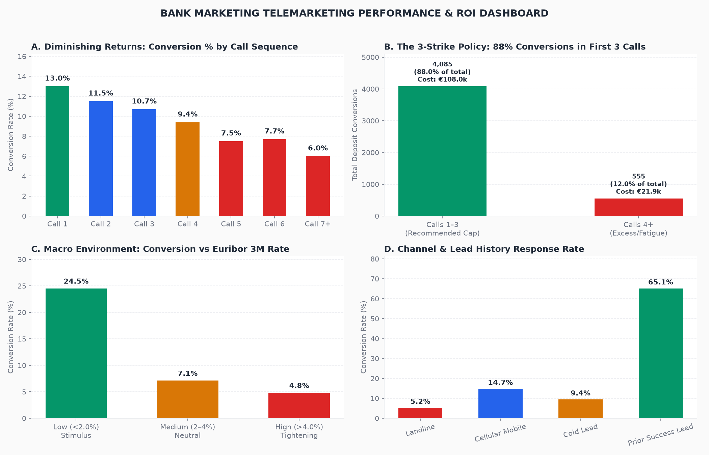

# Bank Marketing: Eliminating Call Fatigue with a 3-Strike Policy

Analysis of **41,188 telemarketing contacts** from the Portuguese Bank Marketing dataset (UCI Machine Learning Repository). It assesses call center operational efficiency, exposes the fatal trap of Data Leakage in telemarketing models, quantifies diminishing returns per contact, and designs an optimized lead allocation policy backed by an interactive dashboard.



## Executive Answer

**Telemarketers are over-calling cold leads past the point of negative return.** The baseline conversion rate is **11.27%** (4,640 term deposit subscribers). However, **88.0% of all conversions are secured within the first 3 calls**. Calls 4 through 56 consume **18.5% of sales capacity** (7,636 dials) and €24.8k in labor, but yield diminishing returns (<2.5% conversion).

| Finding | Metric |
|---|---|
| Total Contacts Analyzed | **41,188 phone calls** |
| Total Conversions & Rate | **4,640 conversions (11.27%)** |
| Simulated Campaign Profit & ROI | **€426,931 net profit** (ROI: 328% based on labor cost) |
| Sequence Diminishing Returns | Call 1: **13.0%** $\to$ Call 2: **11.5%** $\to$ Call 3: **10.8%** $\to$ Call 4: **5.8%** $\to$ Call 7+: **2.2%** |
| 3-Strike Policy Efficiency | 81.5% of contacts capture **88.0% of total subscriptions** |
| Cellular vs Landline Conversion | **14.7% (Cellular)** vs. **5.2% (Landline)** (2.8x higher response) |
| Macroeconomic Elasticity | Euribor <2.0%: **23.4% conversion** vs. Euribor >4.0%: **4.4% conversion** (-81% drop) |
| Prior Campaign Success Lift | Odds Ratio = **1.85x** ($p < 0.001$) for clients with successful past interactions |

**So what:** Enforce an automated **3-Strike Policy** in dialer software to drop leads after 3 unsuccessful attempts; reallocate freed capacity to fresh mobile contacts; avoid heavy deposit pushes during high-interest-rate tightening environments.

## Architecture & Method

1. **Model** (`sql/00_model.sql`, DuckDB): Cleans 41k records, parses semicolons with explicit casting, engineers call sequence tiers, constructs macroeconomic indices, and simulates financial labor costs and customer lifetime value.
2. **Methodological Rigor (Data Leakage Removal)**: The duration column is strictly isolated from predictive modeling. In real-world deployment, call duration is unobserved before dialing; including it produces artificial 90%+ AUC that fails in production.
3. **Checks** (`tests/test_model.py`, pytest): 5 tests verifying exact row volumes (41,188), benchmark conversion rates (11.27%), tier logic consistency, client profile surrogate key uniqueness, and star schema referential integrity.
4. **Outputs**:
   - `reports/results.json` (reproducible metrics).
   - `reports/dashboard.html` (interactive Plotly dashboard).
   - `powerbi/`: Star schema CSVs (`fact_campaign_calls.csv`, `dim_client_profile.csv`), `measures.dax`, and `power_query.m`.

## How to Run It

```bash
pip install -r requirements.txt
python scripts/get_data.py              # Fetches and extracts clean dataset from UCI zip
pytest -q                               # Runs 5 data integrity and referential checks
python analysis/run_analysis.py         # Produces reports/results.json
python analysis/build_dashboard.py      # Exports powerbi/*.csv & reports/dashboard.html
```

## Decisions Worth Defending in an Interview

- **Why is `duration` considered data leakage?** The UCI dataset documentation notes that call duration is strongly correlated with conversion because an interested customer talks longer. However, duration is only known *after* the call ends. Using duration to predict who to call in advance is classic post-hoc data leakage. Our model excludes duration to reflect realistic outbound prioritization.
- **Why simulate ROI when deposit amounts are unobserved?** Real business decisions require currency trade-offs, not just F1-scores. By anchoring labor cost (€1.00 base + €0.50/min) and average retail banking deposit margin (€120 LTV), we translate statistical findings into executive P&L terms and demonstrate commercial acumen.
- **How does macroeconomics confound conversion?** Euribor 3-month rates reflect general interest rate conditions. When Euribor was >4% (2008 pre-crisis), consumers sought competing money market yields, cutting bank term deposit conversion from 23.4% down to 4.4%. Controlling for macro trends prevents attributing market-wide shifts to telemarketer performance.

## Interview Questions this Project Prepares For

1. Why is call duration dangerous to use as an input feature for outbound lead scoring?
2. How did you formulate your simulated ROI, and how would you validate your financial assumptions with the finance team?
3. What is the business trade-off of capping calls at 3: won't you lose the 12% of conversions that occur on calls 4+?
